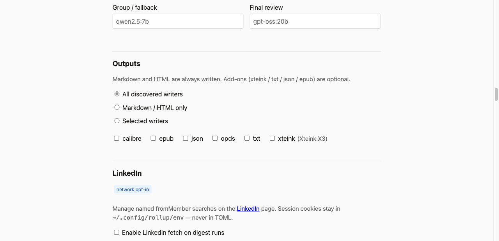

# Output writers

Default Markdown/HTML digests stay in core. Named **output writers** attach after
the report is built and write additional artifacts beside the same run stem.

By default a digest run enables **every discovered writer**. Narrow or disable
with `--output`:

```bash
rollup digest --lookback-days 7                    # md/html + xteink + txt + json + epub
rollup digest --output xteink --lookback-days 7    # md/html + xteink only
rollup digest --output json --output txt --lookback-days 7
rollup digest --output none --lookback-days 7      # Markdown/HTML only
rollup digest --output epub --lookback-days 7      # requires: pip install 'rollup[epub]'
```

Writers are skipped under `--dry-run`. `--xteink` (and compatibility `--x3`) is an
alias for `--output xteink` (selecting any `--output` / `--xteink` replaces the
default-all set). Sticky TOML: `output = ["json", "txt"]`, `output = "none"`, or
`output = "all"`.

When writers are auto-enabled (default-all) and an optional dependency is
missing (e.g. EPUB without ebooklib), that writer is skipped with a warning.
An explicit `--output epub` still fails hard if the dependency is absent.

## Built-in writers

| Name | Files | Notes |
|------|--------|--------|
| `xteink` | `…-newsletter-digest.xteink.md` | E-ink oriented Markdown; short lines; **no external URLs**. See [XTEINK_USAGE.md](XTEINK_USAGE.md). |
| `txt` | `…-newsletter-digest.txt` | Plain text; same offline model as XTEINK (no links / URLs stripped). |
| `json` | `…-newsletter-digest.json` | Structured full rollup (`schema_version` 1). Includes classified links and metadata; **omits** `body_html` / `body_text`. |
| `epub` | `…-newsletter-digest.epub` | Rich ebook (cover, nav, per-folder chapters, summaries); **no external URLs** (same offline model as XTEINK/TXT). Needs `ebooklib` via `pip install 'rollup[epub]'`. |
| `opds` | `…-newsletter-digest.atom.xml` | OPDS 1.2 acquisition feed for **this** briefing (links to sibling EPUB/HTML/Markdown). Optional writer: failure is partial, not a hard stop. Loopback catalog: `GET /opds` while `rollup web` is running. |
| `calibre` | copies into `[calibre].drop_dir` | Copies every artifact of the run (`.epub`, `.atom.xml`, `.html`, `.md`, `.json`, `.txt`, `.xteink.md`) into a Calibre auto-add / watch folder, which must be outside the mail root. **No network.** Optional. Skipped in default-all when `drop_dir` is unset; an explicit `--output calibre` without a drop dir fails. CLI: `--calibre-drop-dir`; `rollup doctor` checks the directory. |

Single-file formats (`txt`, `json`, `epub`) share the core digest stem and only change the extension. XTEINK uses a `.xteink` variant so it does not collide with the core digest `.md`. OPDS uses `.atom.xml`.

Enabled add-on writers are **required** by default (failure blocks `latest.*`). Destination writers (`opds`, `calibre`) are **optional**: the Markdown/HTML briefing still publishes and the run exits 2 (`partial: optional writer` on stderr; `optional_writer_failed` in the manifest `degradations`).

Settings → **Outputs** exposes the same choice (all discovered writers, Markdown/HTML only, or a subset):



## Third-party writers

Packages can register additional writers via the `rollup.output_writers` entry
point group (see README).
